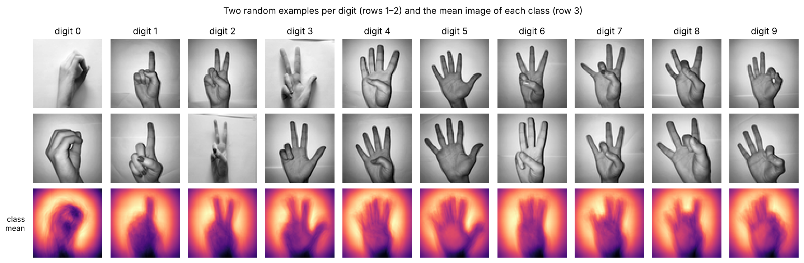
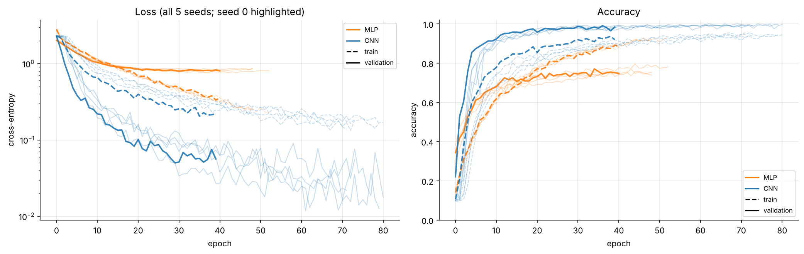
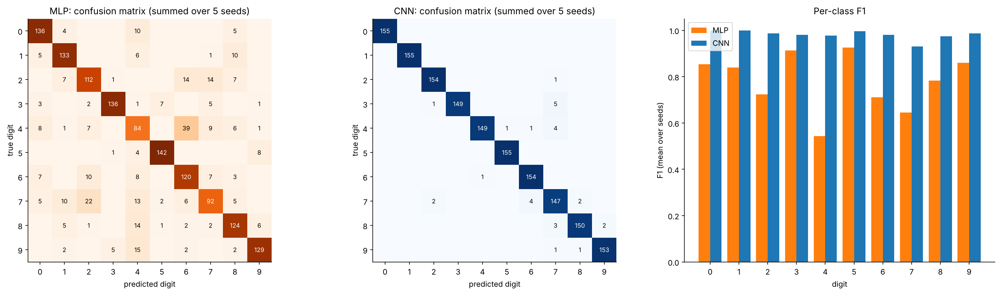
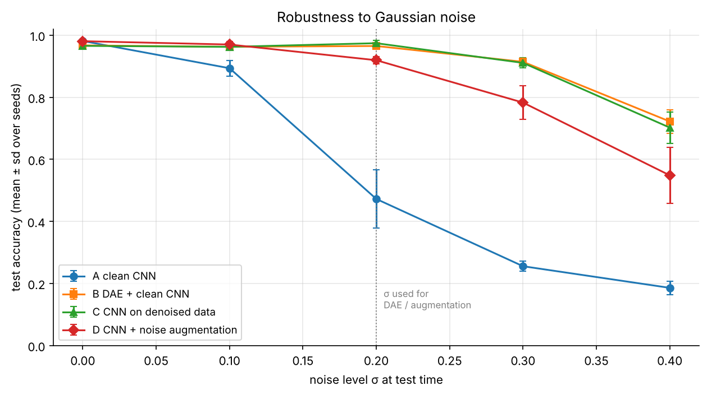

# Sign Language Digits: MLP vs CNN, Hyperparameter Search and Robustness to Noise

Image classification of hand signs for the digits 0–9 (2,062 grayscale images, 64 × 64) with Keras.
The project compares a multilayer perceptron with a convolutional network, tunes both on a validation set,
reports test metrics averaged over five random seeds, and studies how to make the classifier robust to noisy images.

*MSc Machine Learning, University of Thessaly · Machine Learning – Deep Learning, 2025–26*

**Stack:** Python · TensorFlow / Keras · scikit-learn · NumPy · pandas · Matplotlib



---

## Key results

| | MLP | CNN |
|---|---|---|
| Test accuracy (mean ± sd, 5 seeds) | 77.9% ± 0.8% | **98.1% ± 0.4%** |
| Macro F1 | 0.780 | **0.981** |
| Macro ROC-AUC (one-vs-rest) | 0.968 | **0.997** |
| Parameters | 1.08 M | 1.14 M |

* **The CNN wins by 20 points with the same number of parameters.** The difference comes from the architecture's inductive bias (local filters, weight sharing, pooling), not from model size.
* **Data augmentation was the most important hyperparameter:** without it every CNN stayed at 92–94% validation accuracy; with it, 99.0–99.7%.
* **Robustness to Gaussian noise (σ = 0.2):** the plain CNN drops to 47%. A denoising autoencoder in front of it restores **96.5%**, and training with noise augmentation gives 91.9% while keeping full accuracy on clean images.

## Highlights

**Learning curves over 5 seeds.** The MLP overfits early; the CNN keeps improving.



**Where the models make mistakes.** The MLP confuses look-alike signs (4 ↔ 6, 7 ↔ 2); the CNN makes 29 errors in 1,550 predictions.



**Robustness strategies under increasing noise**



## What's inside

| Section | Content |
|---|---|
| Data & EDA | integrity checks, class balance, class-mean images, correlation between classes, PCA |
| Training setup | stratified 70/15/15 split, fixed seeds and deterministic ops, early stopping, checkpointing that never silently resumes training |
| Hyperparameter search | 7 MLP and 9 CNN configurations scored on the validation set (learning rate, size, dropout, input standardisation, augmentation) |
| Final comparison | selected models retrained with 5 seeds: accuracy, precision, recall, F1, ROC-AUC, learning curves, confusion matrices, per-class F1, misclassified examples |
| Robustness | convolutional denoising autoencoder; four strategies compared at noise levels σ = 0–0.4 |

## Findings worth discussing

* **Checkpointing done right.** Loading saved weights before `fit()` silently continues training from a previous run, so results depend on how many times a cell was executed. Here every experiment trains a new model from scratch; weights are loaded only to evaluate without retraining (`TRAIN = False`).
* **Overfitting vs inductive bias.** A 4× larger MLP reaches 99% training accuracy but still 77% on validation; the CNN generalises because translation-equivariant features match the problem.
* **Honest model comparison.** Results are averaged over 5 seeds: with 310 test images, one image is worth 0.3 percentage points, so single-run differences of 1–2 points are noise.
* **Denoising vs augmentation.** Retraining the classifier on denoised images adds nothing beyond using the autoencoder as a front-end. Noise augmentation is simpler and has no cost on clean inputs, but is less robust to heavy noise.
* **Optimisation can fail.** Heavily regularised CNNs sometimes stay at chance level for several epochs. Early stopping only starts counting after epoch 10, and a run that never leaves the plateau is reported and replaced rather than hidden.

## How to run

```bash
git clone https://github.com/ststamatis-art/sign-language-digits.git
cd sign-language-digits
pip install -r requirements.txt
jupyter notebook notebooks/sign_language_digits.ipynb
```

The notebook clones the dataset from GitHub on first run and caches a 64 × 64 version in `data/`.
Full training takes roughly 20–40 minutes on a Colab GPU (about 2 hours on a 2-core CPU). Trained weights are written to `checkpoints/`;
set `TRAIN = False` to reload them instead of retraining.

## Repository structure

```
├── notebooks/
│   └── sign_language_digits.ipynb   # full analysis with outputs
├── figures/                         # figures exported by the notebook
├── requirements.txt
└── README.md
```

## Data

A. Mavi (2020), *A New Dataset and Proposed Convolutional Neural Network Architecture for Classification of American Sign Language Digits*, arXiv:2011.08927.
Dataset: [ardamavi/Sign-Language-Digits-Dataset](https://github.com/ardamavi/Sign-Language-Digits-Dataset) (Turkey Ankara Ayrancı Anadolu High School), licensed under Apache 2.0.
